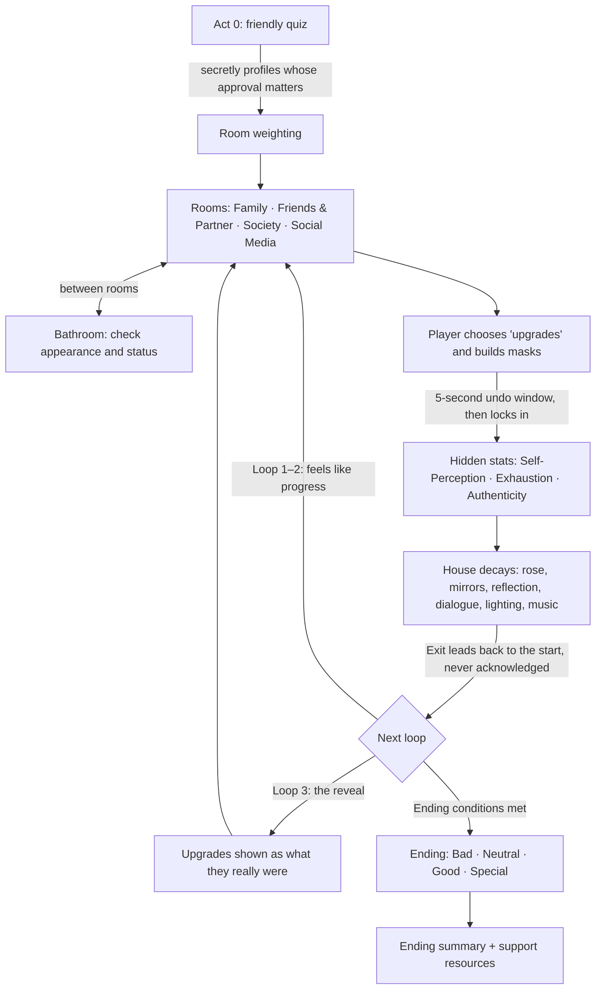

# PRD: Penrose #3

## Change History

| Date | Author | Change |
| --- | --- | --- |
| 2026-10-27 | @sky-yeom (with Copilot) | Initial draft from the concept doc (`penrose.pdf`) and [01 · Market Research](01-market-research.md) |

## Overview

*Penrose* is a 2D hand-drawn psychological horror game. It presents itself as a harmless character-customization / self-improvement game. The player is actually trapped in a house that loops like the Penrose stairs, every "improvement" they choose is destroying the protagonist, and **their choices decide which of four endings the protagonist reaches**. The protagonist can be **male or female**; the player chooses at character creation.

The game is rooted in the creator's lived experience of Korean beauty standards (plastic surgery as a graduation gift, social-media comparison, family pressure framed as love). Its core message: perfection is an illusion, and personal choice and external pressure can't be separated.

**Shape of the product.**

| | |
| --- | --- |
| Platform | **Steam** (Windows, macOS) at launch; a free slice on **itch.io**; consoles and mobile only after launch |
| Business model | Premium, about **$12.99** (range $9.99–$14.99). No microtransactions |
| Length | **2–5 h** first playthrough, replayable for other endings |
| Languages | **English only** |
| Art & sound | Black, white and red pen-and-ink (webtoon/anime linework); distorted K-pop that decays each loop |
| Engine | **Godot 4** (free, no royalties, strong 2D; final call in #8) |
| Team | Owner (@sky-yeom): PM, design, art. Programming, music and a sensitivity reviewer still to be found |
| Target launch | Late **Oct 2028**, during Steam Scream Fest (dated plan in #12) |

**Moodboard (#2)** is in progress; until it lands, art direction follows concept doc §11. **How the game plays** in detail (exact mechanics, ending triggers, dialogue) belongs in the GDD (#4).

## Workflow diagram

The loop, the decay and the reveal are the product. Every system exists to make the player realize, too late, that *they* did this.

## Actors & responsibilities

| Actor | Role | Responsibility in the product |
| --- | --- | --- |
| **The player** | Decision-maker | Makes every choice; is meant to feel complicit, not like a bystander |
| **The protagonist** | Player character | A young man or woman around graduation age, chosen at character creation and "built" by the player; their true self erodes as masks pile up. Name and background still open (Q1) |
| **The four rooms** | Sources of pressure | **Family** (parents and extended family), **Friends & Partner** (friends and a significant other), **Society** (coworkers, bosses, interviewers), **Social Media** (followers, strangers, the algorithm). Each demands a version of the protagonist: the perfect son or daughter, the easy-going friend and ideal partner, the presentable employee, the filtered self. The quiz decides which room is loudest |
| **The Bathroom** | Self-check | Not a source of pressure but the place the protagonist checks themselves: the mirror shows their appearance, and their "status" (how each room currently sees them). Visited between rooms |
| **The mirror / Reflection** | Truth-teller | Lives in the Bathroom. Shows the "improved" protagonist, then the damage. May speak, sparingly |
| **The rose** | Health bar and symbol | A rose in a glass case that loses petals and bleeds as the protagonist loses themselves; the visible stakes of the endings |
| **The house** | The loop | Penrose-stairs architecture that pretends you're making progress while sending you back to the start |
| **The Gumiho (fox)** | Folklore presence | Consuming yourself to become acceptable. Role still open (Q2) |

## Why this matters (business case)

- **Gap today**: Of ~16,000 *Psychological Horror* games on Steam, only **12** also carry *Character Customization + Choices Matter + Multiple Endings + Female Protagonist*, and the only notable one is *Money for Girls: Amortized* (98% positive). On itch.io, all 19 *horror + dress-up* projects are free jam games. Nobody has built the full game about beauty standards and body image, and no one from a Korean perspective.
- **Why now**: disguised-genre horror is still rising (DDLC, MiSide, KinitoPET; *Endacopia* is 2026's top streaming breakout in this space). Indie new-IP breakouts doubled from 13 to 33 in 2026. *Consume Me*, about an eating disorder and strict parenting, won the IGF 2025 Grand Prize, so a personal treatment of this subject can succeed with critics and players.
- **Value**: a short, replayable game that streamers react to and essayists analyze, made distinctive by a Korean voice (Korean-made narrative horror is under-represented).
- **Risk**: the subject can easily read as exploitative. *Project Makeover*'s "ugly → fixed" ads were ruled harmful by US and UK regulators. A first-time, small team is also making hand-drawn art in four decay states per room. The principles, non-goals and P0 safety features below bound both risks. A close competitor, *Fractured Blooms* (Serenity Forge), is announced.

## Target personas

- **Primary — The Lore Diver** (17–28). Plays DDLC, OMORI, Slay the Princess. Wants a real twist, hidden systems, choices that change the ending, and symbols to decode.
- **Primary — The Dark-Aesthetic Dress-Up Fan** (15–25, mostly women and non-binary players). Plays Needy Streamer, Money for Girls, itch.io horror dress-up games. Wants a distinctive look, character customization, and a moment worth clipping.
- **Secondary — The Meaning Seeker** (22–35). Played Mouthwashing, Consume Me, 1000xRESIST; often has lived experience of body image or family pressure. Wants to feel understood and to see the subject respected.
- **Channel — Horror Let's Player / Essayist.** Needs a blind-playable game under 4 hours that reacts well on camera and has depth for analysis.
- **Not a persona**: players looking for a real makeover or dress-up game, or a cozy game. The surface is a disguise, and the store page must not mislead them.

Full personas: [Market Research §9](01-market-research.md#9-target-audience-personas).

## User scenarios

1. *A horror fan picks up what looks like a self-improvement game.* Today: disguised-genre horror games hide supernatural monsters. With Penrose: the "monster" is beauty standards and the people who love you, and the player realizes they caused the damage themselves.
2. *A player finishes and wonders what else could have happened.* Today: many narrative horror games have one fixed ending. With Penrose: the ending reflects their choices, the ending summary shows what the quiz and their choices said about them, and they start a second run to reach a different ending.
3. *A player with lived experience of dysmorphia is hesitant.* Today: they either avoid the game or get blindsided. With Penrose: clear content warnings, an intensity setting and support resources let them play on their own terms and still reach every ending.
4. *A streamer plays blind.* Today: they need a short game with a twist that works on camera. With Penrose: chat spots the repeating wallpaper before the streamer does, the Loop 3 reveal is a big reaction moment, and viewers argue about which ending is "right".
5. *A player unfamiliar with Korean culture starts the game.* Today: culturally specific games either over-explain or turn the culture into exotic decoration. With Penrose: the details (graduation-gift surgery, subway ads, family dynamics) are woven into the English script, specific enough to feel real and clear enough to follow without a glossary.

## Product principles

1. **Critique, never endorsement.** No appearance change is ever presented as genuinely good. Every "upgrade" has a true cost that the game eventually shows.
2. **The player is complicit.** Choices are real, permanent and theirs. The game never lets them off the hook by making the outcome random.
3. **Choices decide the ending.** Different choices must lead to visibly different endings. If endings feel predetermined, replay value and the message both collapse.
4. **The game lies; the design doesn't.** The house and its characters gaslight the player, but content warnings, settings and the store page are honest.
5. **Warn first, let players choose.** Graphic content is opt-down, never a surprise ambush, and there is always a way to reach support resources.
6. **Symbolic, not instructional.** Body horror is surreal and meaningful, never a how-to (follow established safe-messaging guidelines for self-harm and eating disorders).
7. **Specific, not exotic.** Korean cultural detail is accurate and lived-in, drawn from the creator's own experience.

## Goals (in scope)

- Deliver a 2–5 h narrative horror game that feels like harmless self-improvement at first, then reveals itself through the loop, the decay and the Loop 3 reveal.
- Personalize each run: the Act 0 quiz secretly sets which room's pressure is loudest.
- Make every choice permanent after a short undo window, and make choices decide which of four endings the player reaches.
- Make the house visibly decay every loop (rose, mirrors, reflection, room details, dialogue, lighting, music).
- Give players control of the experience: content warnings, an intensity setting, a photosensitivity mode, accessibility basics and support resources.
- Ship on Steam (Windows, macOS) in English, with a free itch.io slice and a Steam Next Fest demo beforehand.
- Build an audience before launch: about 10,000 wishlists through a devlog, the itch.io slice and Next Fest.

## Non-goals (out of scope for this product)

- Not a real dress-up or beauty game. Customization serves the horror; it is not a deep wardrobe system.
- Not a therapy or medical tool. Penrose points to real support resources but claims to treat nothing.
- No microtransactions, cosmetic DLC or ads. Selling "upgrades" would contradict the message.
- No multiplayer, procedural generation or 3D.
- No consoles or mobile at launch. Mobile requires a store-policy review first (Google Play pulled DDLC; app stores reject apps that promote a "negative self-image").
- No full voice acting at launch.
- No marketing that shows "ugly → fixed" played straight, and no marketing that spoils the reveal.

## Features (prioritized, "what" not "how")

### P0 — must exist for the game to be Penrose

P0 is the **MVP**: if any P0 item is missing, it isn't Penrose. The first build to prove it is a **vertical slice** (the quiz, then the Family Room and the Bathroom at final art quality, through all four decay states, ending in one ending).

1. **Act 0 personality quiz**: a friendly-seeming quiz that secretly measures whose approval the player values most, what they value, and how they react to criticism, with no visible sign that it is measuring anything.
2. **Four quiz-weighted rooms and the Bathroom**: Family, Friends & Partner, Society and Social Media rooms, each one a source of pressure. The quiz profile changes which room's pressure is loudest. Between rooms, the Bathroom lets the protagonist check their appearance and status in the mirror; it's also where the damage is eventually faced.
3. **Character creation and permanent self-improvement choices**: the player picks a male or female protagonist, then makes physical and style "upgrades" and builds a mask per room. Upgrade paths follow real gendered ideals (e.g. thinness and facial surgery, or muscle and height) but either protagonist can face any pressure. Each choice locks in after a short undo window (about 5 seconds; decision time and undo use are recorded).
4. **The hidden loop**: the house loops without ever admitting it, and characters gaslight the player ("Didn't we already talk about this? …No, first time, I swear").
5. **Decay across loops**: rose, mirrors, reflection, room details, dialogue and lighting each have four states (Loop 1, 2, 3, 4+), as in the concept doc §7 table.
6. **The reveal**: in Loop 3, each upgrade is shown for what it really was. It respects the intensity setting.
7. **Hidden stats**: Self-Perception, Exhaustion and Authenticity track what is really happening and feed the endings.
8. **Four endings decided by choices**: Bad, Neutral, Good, Special. All reachable, none soft-locked. The exact trigger rule is decided in the GDD (Q7).
9. **Player safety**: content warnings on first launch and on the store page, an intensity setting that tones down graphic body horror without removing story or endings, a photosensitivity mode that removes the Loop 4+ strobing, and a support-resources screen (international) reachable from the menu and after every ending.
10. **Accessibility baseline**: text size and speed, rebindable controls, captions for important sounds, and a non-colour cue (shape or motion) for everything red signals.
11. **Save / load**: autosave at room transitions, plus manual slots.
12. **English script** that makes Korean cultural details clear without over-explaining them.
13. **Steam release for Windows and macOS**, with cloud saves.

### P1 — what makes it memorable and replayable

14. **Ending summary**: after an ending, show which ending it was and what the quiz and choices measured about the player. Shareable, with no personal data leaving the device.
15. **Social Media Room as an in-game phone/feed**: infinite scroll, filters and comments that feel real in Loop 1 and corrupt later.
16. **Distorted K-pop soundtrack**: clean pop that detunes, glitches and stutters each loop, including a catchy standalone theme song for marketing.
17. **The Reflection**: the mirror self speaks, sparingly. Playtesters must not find it annoying.
18. **Light and angle puzzles**: moving lights or angles reveals distorted, accurate or idealized reflections; at least one per room.
19. **Extra personality measures**: risk tolerance, social conformity and self-compassion, each affecting dialogue or endings.
20. **Chapter select** after the first ending, for replaying toward other endings.
21. **Steam achievements**: one per ending plus loop and secret milestones (these also measure completion and ending distribution).
22. **Free itch.io slice and Next Fest demo**: the quiz plus the first loop, giving a taste of the decay without spoiling the reveal.

### P2 — if time allows

23. **Extra rooms** (e.g. a Bedroom as a possible safe space) only if the five core spaces are finished.
24. **The Gumiho**: in-scene fox presence, once its role is decided (Q2).
25. **Steam Deck support**: full controller support and text readable at 1280×800.
26. **Opt-in, anonymous telemetry** for playtests and launch (events defined in #10).
27. **Linux build**, if the engine makes it cheap.

## Features out (explicitly decided against, for now)

- Paid cosmetics, an in-game shop or any real-money "upgrades".
- A deep fashion or wardrobe system with many items. Customization stays small and meaningful.
- An open-ended sandbox house. The loop is authored.
- Full voice acting, and any language other than English.
- Console and mobile versions at launch.

## Success metrics

- **About 10,000 Steam wishlists** at launch.
- **Next Fest demo median playtime of 30 minutes or more** (shows the hook holds).
- **90% or more positive** Steam reviews 30 days after launch.
- **1,000+ Steam reviews** in the first 12 months (a "niche hit", roughly 30–60k copies).
- **Choices visibly matter**: every ending reached by at least 5% of players who finish, and no ending by more than 60%.
- **50% or more** of players reach an ending; **25% or more** of those start a second run.
- **The loop and the complicity land** in playtests: 70% or more notice the loop by Loop 3, and 70% or more say they felt responsible.
- **At least 5 creator videos or streams** from channels with 100k+ subscribers within 60 days of launch.
- **Zero marketing assets** that show "ugly → fixed" played straight or spoil the reveal.

**Baseline required first.** The playtest targets can't be checked until there's something to play. The vertical slice (quiz plus two rooms through all four decay states) is the first playtest baseline (#15). Sales and wishlist targets come from the comparable games in [Market Research §11](01-market-research.md#11-opportunity-sizing--benchmarks).

## Open questions

Decided so far: core message, setting, room roles, the hidden loop and its denial, permanent choices, the quiz's hidden purpose, the palette, the music style, four endings. Still open:

| # | Question | Decide in |
| --- | --- | --- |
| Q1 | Protagonist's name, age and background | GDD #4 |
| Q2 | The Gumiho's role: guide, villain, the protagonist themselves, or symbol only | GDD #4 |
| Q3 | Is there a point of no return, and when? | GDD #4 |
| Q4 | Which loop-breaking mechanic(s) resolve the game? | GDD #4 |
| Q5 | How autobiographical vs. fictional is the story? | GDD #4 |
| Q6 | How graphic is the body horror at the default intensity? | GDD #4 |
| Q7 | What decides the ending: choices only, or also quiz profile and rose state? | GDD #4 |
| Q8 | Confirm Godot 4 | Architecture #8 |
| Q9 | Who programs, who composes, who reviews for sensitivity? | Before the prototype |
| Q10 | Weekly hours and budget available (drives the schedule) | Milestones #12 |
| Q11 | Confirm the price and the Oct 2028 launch window | Before the Steam page goes live |
