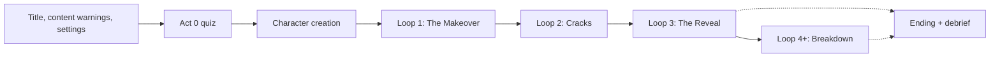

# GDD: Penrose #4

> **What this doc is:** the overall Game Design Document, describing **how Penrose plays**. Each section is a short summary; the details live in the linked design docs in [`design/`](design/). The [PRD](03-prd.md) says *what* we're building and *why*; the GDD says *how*.
>
> **Legend:** **[Decided]** owner's direction · **[Proposed]** recommendation, needs sign-off · **[Open]** needs a decision.

## Change History

| Date | Author | Change |
| --- | --- | --- |
| 2026-10-28 | @sky-yeom (with Copilot) | Overall GDD + detailed design docs drafted for review |

## Design docs

| # | Doc | Status | Concept open questions it answers |
| --- | --- | --- | --- |
| 0 | [Act 0 Quiz](design/act0-quiz.md) | ✅ Approved | — |
| 1 | [Core Loop](design/core-loop.md) | 📝 Draft for review | — |
| 2 | [Rooms](design/rooms.md) | 📝 Draft for review | — |
| 3 | [Upgrades & Reveals](design/upgrades-and-reveals.md) | 📝 Draft for review | Q6 How graphic |
| 4 | [Loop Structure & Decay](design/loop-and-decay.md) | 📝 Draft for review | Q3 Point of no return |
| 5 | [Endings & Breaking the Loop](design/endings.md) | 📝 Draft for review | Q4 Loop-breaking, Q7 What decides the ending |
| 6 | [Characters & Story](design/characters-and-story.md) | 📝 Draft for review | Q1 Protagonist, Q2 Gumiho, Q5 Autobiographical |
| — | [Systems](design/systems.md) | 📝 Draft for review | — |
| 7 | [Presentation](design/presentation.md): puzzles, UI, art, audio, settings | 📝 Draft for review | — |

Recommended review order is top to bottom: each doc builds on the ones above it.

---

## 1. Overview

**Pitch [Decided].** It looks like a harmless character-customization / self-improvement game. You're actually trapped in a house that loops like the Penrose stairs, every "improvement" you choose is destroying the protagonist, and your choices decide how it ends.

**Experience arc [Decided].** Comfortable → complicit → trapped → horrified → offered recovery.

**Design pillars [Proposed].** Every feature must serve at least one.

| Pillar | Means |
| --- | --- |
| **You did this** | The player performs every harmful change themselves. Nothing bad happens *to* the protagonist that the player didn't choose |
| **Progress is a lie** | Every system feels like it's moving forward while it's going in circles |
| **Whose eyes?** | Every room is someone else's gaze; the Bathroom mirror is the protagonist's own |
| **Sweet surface, honest design** | Loop 1 feels harmless; warnings, settings and support resources are always honest |

## 2. Game flow

| Act | Loop | Experience [Decided] |
| --- | --- | --- |
| 0 | — | A harmless-looking personality quiz |
| 1 · The Makeover | 1 | A lighthearted makeover life-sim; everyone praises you; the rose is in full bloom |
| 2 · Cracks | 2 | Déjà vu: repeating details; NPCs deny repeating themselves; the reflection flickers |
| 3 · The Reveal | 3 | Every upgrade is shown for what it really was; dialogue repeats word for word; the rose bleeds |
| 4 · Breakdown | 4+ | Rooms bleed together; text corrupts; the UI glitches; the game never admits it's looping |

---

## 3. Act 0 quiz → [details](design/act0-quiz.md)

Six random-seeming questions, each grounded in psychology research: houseplant (need to belong), wake-up sound (social reward), attic box (extended self), painting (looking-glass self), postcard (possible selves), and "Did you answer all the questions truthfully?" Q1–Q5 decide which room is loudest. Everything else (appearance ideal, criticism style, self-checking, self-image, core belief) is measured in play.

## 4. Core loop → [details](design/core-loop.md)

Each loop, the player visits all four rooms in any order (the loudest room "calls"), stopping at the Bathroom mirror when they want. In a room, someone comments on their appearance → the player responds → chooses to accept or refuse an upgrade → if they accept, they **do** it in a 30–90 second mini-game → a ~5 second undo window → it locks in forever. **[Proposed]** Dialogue + mini-game, because doing the harm (not just agreeing to it) is what makes the player complicit.

## 5. Rooms → [details](design/rooms.md)

| Room | Pressure from | Mask it builds |
| --- | --- | --- |
| **Family** | Parents, siblings, extended family | The Perfect Child |
| **Friends & Partner** | Friends, a significant other | The Easy One |
| **Society** | Coworkers, a boss, interviewers | The Presentable One [Proposed] |
| **Social Media** | Followers, strangers, the algorithm | The Filtered Self |
| **Bathroom** | The protagonist's own gaze | — (the mirror shows all the others) |

Each room is grounded in body-image research (Tripartite Influence Model, fat talk, social-media comparison, filtered selfies) and Korean context (graduation-gift surgery, holiday nagging, lookism in hiring).

## 6. Upgrades & reveals → [details](design/upgrades-and-reveals.md)

| Path | Loop 1 mini-game | Loop 3 reveal |
| --- | --- | --- |
| Leaner | Wardrobe | Cutting away pieces of yourself |
| Flawless skin | Skincare + ring light | Chemical burns and bleaching |
| Sharper features | Photo-editing sliders | The sliders were scalpels |
| Stronger [Proposed] | Training rhythm game | Body pulled and stitched to look bigger |

**Reveal [Proposed]:** the same mini-game, same controls, shown truthfully. **How graphic [Proposed]:** stylized pen-and-ink by default, never realistic or instructional; three intensity levels (Full · Softened · Symbolic) that all keep the full story.

## 7. Loop structure & decay → [details](design/loop-and-decay.md)

Every staircase goes up, and the last one leads back to the start. **[Proposed]** Each loop resets differently (sleep → seamless hallway → door of white light) and uses **change blindness** so the repetition is felt before it's noticed. Everything decays per loop (rose, mirrors, reflection, rooms, dialogue, lighting, music). **Point of no return [Proposed]:** you can never undo, but you can always stop, until the last petal falls.

## 8. Endings → [details](design/endings.md)

| Ending | Way out | Trigger [Proposed] |
| --- | --- | --- |
| **Bad** | Let the rose die | The last petal falls |
| **Neutral** | Destroy the mirrors | Smash the Bathroom mirror (escape by avoidance: you leave with a pocket mirror) |
| **Good** | Refuse to change | Resistance ≥ 8 after the reveal: the front door leads outside |
| **Special** | Sit with your reflection | Good path + describe your reflection kindly in natural light: mirrors become windows, petals regrow |

**What decides the ending [Proposed]:** the player's choices; the rose is a gate; the quiz never decides. Grounded in body-dysmorphia research (avoidance keeps the problem going; mirror exposure and self-compassion help).

## 9. Characters & story → [details](design/characters-and-story.md)

**Protagonist [Proposed]:** 19, just graduated; male or female **[Decided]**; default name Haneul (하늘), renamable; deliberately blank so the player's choices are theirs. **Gumiho [Proposed]:** a symbol of the true self, glimpsed in every loop and always running away. In the retellings where a gumiho becomes human only by going 1,000 days *without* eating, Resistance is the "days without eating". **Autobiographical [Proposed]:** fiction rooted in truth, with an optional creator's note.

## 10. Systems → [details](design/systems.md)

| System | Summary [Proposed] |
| --- | --- |
| **The Rose = Authenticity** | 12 petals; −1 per upgrade; 0 = Bad ending; the last two are protected until Loop 3 |
| **Self-Perception** | Starts at the first mirror rating; rises with early upgrades (the illusion), falls from Loop 3; drives mirror distortion |
| **Exhaustion** | Rises with upgrades and masks; shrinks the undo window |
| **Masks** | 3 pieces per room; a complete mask answers for you |
| **Resistance** | +1 per refusal or undo; 8 opens the way out |

## 11. Presentation → [details](design/presentation.md)

Three kinds of light (flattering, harsh, natural) drive the reflection puzzles. Diegetic UI: the mirror is the stats screen, the rose is Authenticity, and the Social Media Room is a phone. Black, white and red pen-and-ink **[Decided]** (to be refined by the moodboard, #2). Distorted K-pop that decays each loop **[Decided]**, one theme per room on a shared melody. Content warnings, three intensity levels, photosensitivity mode, support resources and accessibility baseline.
