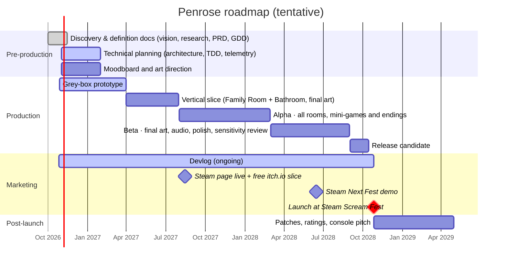
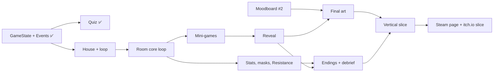

# High-Level Product Roadmap: Penrose #11

## Change History

| Date | Author | Change |
| --- | --- | --- |
| 2026-10-29 | @sky-yeom (with Copilot) | First roadmap: phases, timeline, features per phase, gates, dependencies, cut list |

> **What this doc is:** the strategic overview of **what gets built when**, from today to launch and beyond, aligned with the [Product Vision](00-product-vision.md)'s long-term goals and the [PRD](03-prd.md)'s scope. It's about **order and priority**; exact dates and capacity go in the Milestone Schedule (#12).
>
> **⚠️ Tentative.** Weekly hours and team (PRD open questions Q9, Q10) aren't decided yet, so dates are targets, not commitments. The launch window (late Oct 2028, Steam Scream Fest) is fixed; scope flexes to fit it (see the cut list, §7).

---

## 1. How this roadmap works

- **Stage gates between phases:** a phase ends only when its exit criteria are met. This is the Waterfall-style part, and it suits the docs and the big milestones.
- **Short iterations inside each phase:** 2-week cycles, each ending in a playable build, with automated tests running continuously and a playtest at every gate. This catches the risks only play can reveal (does the loop feel right? does the reveal land?).
- **Riskiest things first:** the grey-box prototype tests the loop, the reveal and the quiz disguise *before* any final art is drawn, because hand-drawn art in four decay states is the most expensive thing to redo.

## 2. Timeline

## 3. Now / Next / Later

| | Now (Oct 2026 – Mar 2027) | Next (Apr 2027 – Feb 2028) | Later (Mar 2028 onward) |
| --- | --- | --- | --- |
| **Theme** | *Prove it works* | *Prove it lands, then build it all* | *Make it beautiful, ship it, grow it* |
| **Product** | Docs signed off; grey-box prototype of the full loop | Vertical slice; Steam page; itch.io slice; alpha | Beta, Next Fest demo, launch; patches and ports |
| **Vision horizon** | — | — | Launch → +2 years ([vision §5](00-product-vision.md)) |

## 4. Phases, features and gates

Feature numbers refer to the [PRD](03-prd.md) priority lists: **P0** = must-have, **P1** = should-have, **P2** = could-have.

| Phase | Goal | Features built | Exit gate (all must be true) |
| --- | --- | --- | --- |
| **Pre-production** | Agree what we're making and how | Docs #1–#16, vision (#24), personas (#26), canvas (#27), player research (#28) | PRD and GDD signed off; engine confirmed; player research run |
| **Grey-box prototype** | Prove the loop *feels* right, with no art | P0 #1 quiz ✅ · P0 #2 rooms (grey boxes) · P0 #3 choices + undo window · P0 #4 hidden loop · P0 #5 decay hooks · P0 #6 reveal (placeholder) · P0 #7 hidden stats · P0 #8 four endings · P0 #11 save/load ✅ · one placeholder mini-game | All 4 endings reachable; playtest: ≥ 70% notice the loop by Loop 3; the quiz disguise holds (≤ 20% guess it) |
| **Vertical slice** | Prove the hook end to end at final quality | Family Room + Bathroom with final art in all 4 decay states · skincare mini-game · the rose · the Reflection (P1 #17) · first audio decay (P1 #16) · content warnings + intensity (P0 #9) | Playtest: ≥ 70% "felt responsible"; ≤ 15% "too much"; art cost per room measured, so the alpha plan is realistic |
| **Alpha** | Everything playable, rough edges allowed | All 4 rooms + Bathroom · all 4 upgrade mini-games and reveals · masks · Resistance · ending debrief (P1 #14) · phone feed UI (P1 #15) · light puzzles (P1 #18) · personality measures (P1 #19) | Every P0 and P1 feature in; no soft-locks; full playthrough 2–4 h |
| **Beta** | Final quality | Final art and audio · accessibility baseline (P0 #10) · photosensitivity mode · support resources · chapter select (P1 #20) · achievements (P1 #21) · streamer mode (from the [canvas](01-value-proposition-canvas.md)) · sensitivity review | Release criteria met; sensitivity review passed; Next Fest demo median playtime ≥ 30 min |
| **Release candidate** | Ship | Bug fixing only; Steam builds (Windows, macOS, P0 #13) | Zero known crash bugs; store page, trailer, press kit ready |
| **Post-launch** | Grow toward the vision | Patches · age ratings · console port pitch (via a porting partner) · Steam Deck (P2 #25) · Linux (P2 #27) · mobile only after a store-policy review | — |

## 5. Prioritization

1. **P0 before P1 before P2** (the PRD's MoSCoW-style tiers).
2. **Within a tier, riskiest first:** features that test an unproven assumption (loop feel, reveal, quiz disguise, intensity settings) come before features we already know how to build.
3. **Systems before content:** the shared game state, the loop and data-driven content come first, so rooms, dialogue and art plug in without rework.
4. **Art last within each feature:** grey boxes until the design is proven.

## 6. Dependencies

## 7. Cut list

If time runs short, cut from the top. **Never cut:** P0 features, player-safety features (warnings, intensity, photosensitivity, support resources) or the Stronger path (needed for male players).

| Order | Cut | Impact |
| --- | --- | --- |
| 1 | Linux build (P2 #27) | Small audience |
| 2 | Opt-in telemetry (P2 #26) | Rely on playtests and Steam achievements instead |
| 3 | Extra rooms such as a Bedroom (P2 #23) | Not in the core design |
| 4 | Gumiho as an in-scene character (P2 #24) | Keep it as a symbol in the art only |
| 5 | Steam Deck verification (P2 #25) | Still playable; just not verified |
| 6 | Light puzzles outside the Bathroom (P1 #18) | Keep the Bathroom puzzle, which the Special ending needs |
| 7 | Chapter select (P1 #20) | Replays start from the beginning |
| 8 | Room theme variations (one theme per room) | Use one main theme with decay |

## 8. Key dates

| Date (target) | Milestone |
| --- | --- |
| Mar 2027 | Grey-box prototype gate |
| Jul 2027 | Vertical slice gate |
| **Aug 2027** | **Steam page live + free itch.io slice** (about 14 months of wishlist building) |
| Feb 2028 | Alpha gate |
| **Jun 2028** | **Steam Next Fest demo** |
| Aug 2028 | Beta gate |
| **Late Oct 2028** | **Launch during Steam Scream Fest** |

## 9. Related

- [Product Vision](00-product-vision.md) (#24) · [PRD](03-prd.md) (#3) · [GDD](04-gdd.md) (#4)
- Milestone Schedule (#12): dates, capacity and buffers, mirrored as GitHub Milestones
- User Stories (#7): break each phase's features into stories
