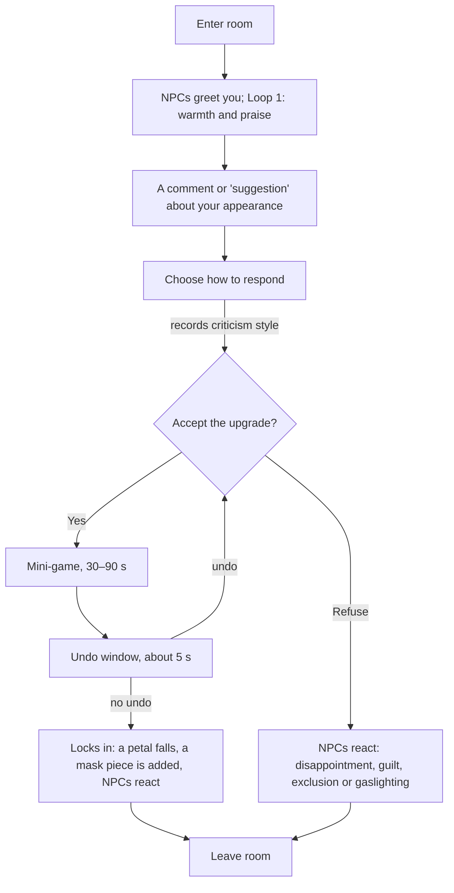

# Core Loop

> **Part of:** [GDD](../04-gdd.md) (#4) · **Step 1** · **Status:** Draft for review · **Last updated:** 28 Oct 2026
>
> **Question this doc answers:** what does the player actually *do*, minute to minute, inside a room and across a loop?
>
> **Legend:** **[Decided]** owner's direction · **[Proposed]** recommendation, needs sign-off · **[Open]** needs a decision.

---

## 1. Summary

Each loop, the player visits four rooms (Family, Friends & Partner, Society, Social Media) in any order, stopping at the Bathroom mirror when they want. In each room, people they care about comment on their appearance and offer an "improvement". The player responds, chooses whether to accept, and if they accept, *does* the improvement in a short mini-game. A few seconds later it locks in forever.

The loop is designed around one pillar: **"You did this."** The player never watches harm happen; they perform it.

---

## 2. What the player does in a room

**Recommended: dialogue + a short mini-game. [Proposed]**

| Option | For | Against |
| --- | --- | --- |
| (a) Dialogue and choices only | Cheapest; closest to a visual novel | The player only *agrees*; they never *do* it. Weakens "You did this" |
| (b) Mini-games only | Hands-on; the Loop 3 reveal can replay the same mini-game with the truth shown | Characters and pressure get thin |
| **(c) Mix** ✅ | Dialogue gives the pressure its context; the mini-game makes the player complicit; Loop 3 replays the *same* mini-game, revealed | Needs one mini-game per upgrade path (four total) |

**Why doing beats agreeing.** Psychology consistently finds that people take more ownership of outcomes they physically produce than of outcomes they only approve, and they justify their own actions after the fact (**cognitive dissonance**; Festinger, 1957). A player who *played* the cute skincare mini-game feels the Loop 3 reveal as "I did that," not "the game showed me that."

---

## 3. One room visit

| Beat | What happens | Design notes |
| --- | --- | --- |
| **1. Enter** | The room's characters greet the protagonist | How loud the room is (quiz) sets how many demands it makes and how personal they get ([rooms](rooms.md)) |
| **2. The suggestion** | A character comments on the protagonist's appearance | Loop 1 frames it as care or fun: "You'd look so fresh with brighter skin!" Later loops escalate: "That's good, but what about…" |
| **3. Respond** | Five reply types: accept it and feel bad · fix it · push back · change the subject or leave · shrug it off kindly | Records **criticism style**, which decides how NPCs pressure the player from Loop 2 ([quiz design §5](act0-quiz.md)) |
| **4. Accept or refuse** | Accepting starts a mini-game; refusing is always allowed | **Illusion of choice [Decided]:** refusing never feels like the "right" answer in the moment; the room reacts socially |
| **5. Mini-game** | 30–90 s, one per upgrade path | Cute in Loop 1; the same game is revealed in Loop 3 ([upgrades & reveals](upgrades-and-reveals.md)) |
| **6. Undo window** | About 5 s to take it back **[Decided]** | Whether and how quickly the player undoes it measures regret sensitivity. High Exhaustion shrinks the window ([systems](systems.md)) |
| **7. Lock in** | Permanent **[Decided]**. A rose petal falls, a piece of the room's mask is added, NPCs react | In Loop 1 the petal falls *off-screen* and the NPCs praise the change. The player only notices the rose changing on their next Bathroom visit |

---

## 4. One loop

| Element | Proposal | Why |
| --- | --- | --- |
| **Room order** | Free choice from the staircase hub; the **loudest room "calls"** (its door is ajar, music leaks out) | Feels free (illusion of choice); lets us measure where the player spends time (needed when quiz Q6 is "No") |
| **Rooms per loop** | All four must be visited to end a loop | Every pressure source is felt every loop |
| **Bathroom** | Optional between rooms; **the first visit in Loop 1 is required** (sets the self-image baseline) | The mirror shows appearance and status, and asks for a 0–10 rating. How often the player checks is itself measured ([systems](systems.md)) |
| **Upgrade offers per visit** | Loop 1: 1 · Loop 2: 1–2 (loud rooms 2) · Loop 3+: 2–3 | Pressure escalates; mirrors "That's good, but what about…" |
| **Ending a loop** | After the fourth room, a way out appears and leads back to the start | Hidden loop **[Decided]**; method in [loop & decay](loop-and-decay.md) |

---

## 5. Pacing

| Unit | Target | Notes |
| --- | --- | --- |
| Mini-game | 30–90 s | Short enough to stay "cute"; long enough to feel like effort |
| Room visit | 5–10 min in Loop 1; shorter later as dialogue repeats | |
| Loop | 30–45 min | Four rooms plus Bathroom visits |
| First playthrough | **2–4 h** | PRD target 2–5 h; under 4 h suits streamers |

---

## 6. Movement and camera

**Side-scrolling house** with Penrose-stair transitions between floors and mirror transitions into the Bathroom (concept doc §11, recommended combination). Click to interact; full controller support. Details in [presentation](presentation.md).

---

## 7. Decisions

| # | Decision | Recommendation |
| --- | --- | --- |
| G1 | What the player does in a room | **(c) Mix**: dialogue + a short mini-game per upgrade |
| G2 | Room order | **Free choice**, with the loudest room "calling" |
| G3 | Must all four rooms be visited each loop? | **Yes** |
| G4 | Is the Bathroom optional? | **Yes**, except the first visit in Loop 1 |
| G5 | Mini-game length | **30–90 seconds** |
| G6 | Can the player refuse every upgrade? | **Yes**. Refusing is how the loop can be broken ([endings](endings.md)), but the rooms push back socially |
| G7 | When does the player first *see* a petal fall? | **Not in Loop 1.** The rose changes off-screen, so the first Bathroom visit in Loop 2 is the first "crack" |

## Sources

- Festinger, L. (1957). *A Theory of Cognitive Dissonance.* Stanford University Press.
