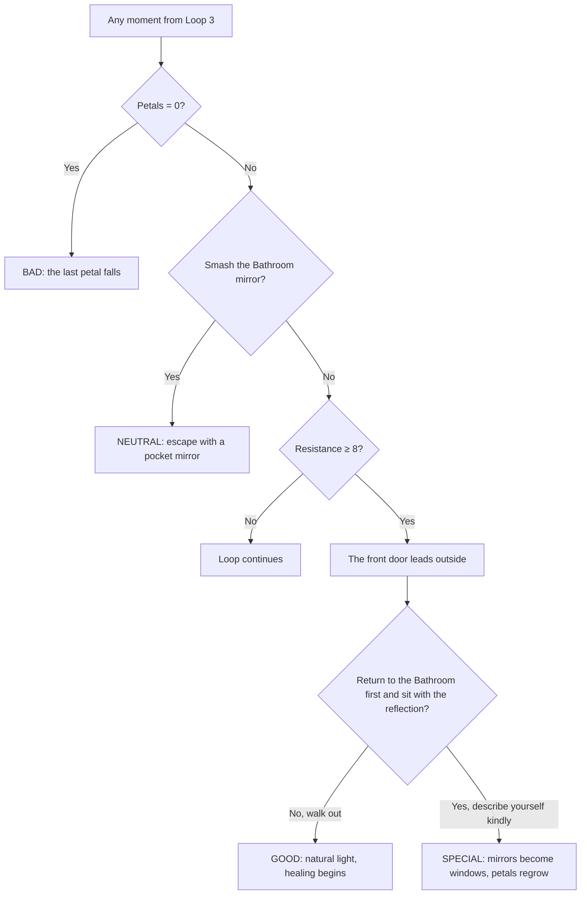

# Endings & Breaking the Loop

> **Part of:** [GDD](../04-gdd.md) (#4) · **Step 5** · **Status:** Draft for review · **Last updated:** 28 Oct 2026
>
> **Question this doc answers:** how can the loop be broken, what decides which ending the player gets, and what does each ending say?
>
> **Legend:** **[Decided]** owner's direction · **[Proposed]** recommendation, needs sign-off · **[Open]** needs a decision.

---

## 1. Four endings, four ways out

The concept doc listed four possible ways to break the loop (open question 4). **Recommendation: use all four, one per ending. [Proposed]** That makes the ending a direct result of *how* the player tried to get out, which is what the PRD requires ("choices visibly decide the ending").

| Ending | Way out (concept doc) | Trigger [Proposed] | Message |
| --- | --- | --- | --- |
| **Bad** | **Let the rose die** | The last petal falls (0 petals, Loop 3 or later) | Total self-destruction **[Decided]**. Chasing every standard costs everything |
| **Neutral** | **Destroy the mirrors** | From Loop 3, the player smashes the Bathroom mirror (petals ≥ 1) | Escape by avoidance. Damaged but alive, leaving with a **pocket mirror** of unresolved insecurity **[Decided]** |
| **Good** | **Refuse to change** | Resistance reaches 8 after the Loop 3 reveal (petals ≥ 1); the front door leads outside | You stop before the last petals fall and begin healing. Light becomes natural and soft **[Decided]** |
| **Special** | **Accept the loop: sit with your reflection** | The Good conditions, **plus** a final Bathroom moment in natural light where the player describes their reflection neutrally or kindly instead of judging it | "Beauty is in the eye of the beholder." Mirrors become windows; you see others trapped in the same prison; petals slowly regrow **[Decided]** |

**Rule [Decided]:** the rose is restored only by true love, and here self-love is true love. Only the Special ending regrows petals.

### 1.1 Why the mapping is psychologically honest

- **Neutral = avoidance.** Smashing the mirror feels like freedom, but in body dysmorphia, **avoidance and safety behaviors keep the problem going**: they bring short-term relief and stop the belief from ever being tested (Veale, 2004). So the protagonist leaves but takes a pocket mirror with them.
- **Special = exposure with self-compassion.** **Mirror exposure**, looking at yourself steadily and describing what you see without judgment, is a real treatment for body-image distress (Delinsky & Wilson, 2006). Treating yourself with kindness rather than harsh judgment is the core of **self-compassion** (Neff, 2003). The Special ending is Penrose's version of that therapy.
- **Good = stopping the behavior.** Refusing upgrades is the game's version of stopping the harmful behavior. It's enough to get out, but not yet to heal what was lost.

---

## 2. What decides the ending (concept open question 7)

**Recommendation: the player's choices decide the ending; the rose acts as a gate; the quiz does not decide endings. [Proposed]**

| Input | Role | Why |
| --- | --- | --- |
| **Choices** (accept, refuse, undo, smash the mirror, how you describe your reflection) | **Decide** which ending | PRD: choices must visibly matter |
| **The rose** (petals left) | **Gate**: at 0, the Bad ending happens no matter what | Makes the stakes visible |
| **The quiz** | Flavors the run (loudest room, Reflection's lines, ending summary) but **never** decides the ending | It would feel unfair to be "doomed" by a personality quiz |

### 2.1 Ending flow

---

## 3. The endings, scene by scene [Proposed]

| Ending | Final scene | Last choice |
| --- | --- | --- |
| **Bad** | The rose has one petal left. NPCs from every room gather in the Bathroom doorway, praising. The petal falls | The player can **hold the last petal** or **let it go**. Letting go (grieving the old self) adds a short coda: a seed in the empty glass case. The ending is still Bad, but it isn't hopeless |
| **Neutral** | The mirror shatters; the house folds flat like paper; the protagonist walks out at night | In the epilogue, the protagonist checks a small pocket mirror before entering a room. The player can't stop them |
| **Good** | The front door opens onto morning. Real light, no red | The protagonist leaves without the masks; the room voices fade |
| **Special** | Natural light fills the Bathroom. The Reflection asks, "What do you see?" The player picks plain or kind descriptions. The mirror becomes a window: other houses, other people looping | The protagonist knocks on another house's window. Petals regrow |

---

## 4. Ending summary (all endings)

After every ending, a short **debrief** ([quiz design §7](act0-quiz.md)):
- Which ending, and which way out the player chose
- What the quiz answers meant and which room was loudest
- The player's Q6 honesty answer next to what their choices revealed
- First and last mirror ratings
- Upgrades accepted vs. refused
- Support resources (PRD P0 #9)
- A hint that other endings exist, without spoilers

## 5. Replay

Chapter select unlocks after the first ending (PRD P1 #20). Each ending has a Steam achievement (PRD P1 #21), which also measures ending distribution (PRD goal: every ending ≥ 5% of finishers).

## 6. Decisions

| # | Decision | Recommendation |
| --- | --- | --- |
| E1 | One way out per ending | **Yes**, as in §1 |
| E2 | What decides the ending | **Choices**; rose as a gate; quiz never decides |
| E3 | Earliest loop an ending can happen | **Loop 3** (after the reveal) |
| E4 | "Let the rose die" as a final choice in the Bad ending | **Yes**, with the seed coda |
| E5 | Special requires the Good path first | **Yes** |

## Sources

- Veale, D. (2004). Advances in a cognitive behavioural model of body dysmorphic disorder. *Body Image*, 1(1), 113–125.
- Delinsky, S. S., & Wilson, G. T. (2006). Mirror exposure for the treatment of body image disturbance. *International Journal of Eating Disorders*, 39(2), 108–116.
- Neff, K. D. (2003). Self-compassion: An alternative conceptualization of a healthy attitude toward oneself. *Self and Identity*, 2(2), 85–101.
